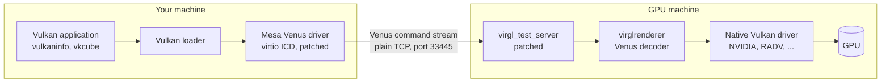
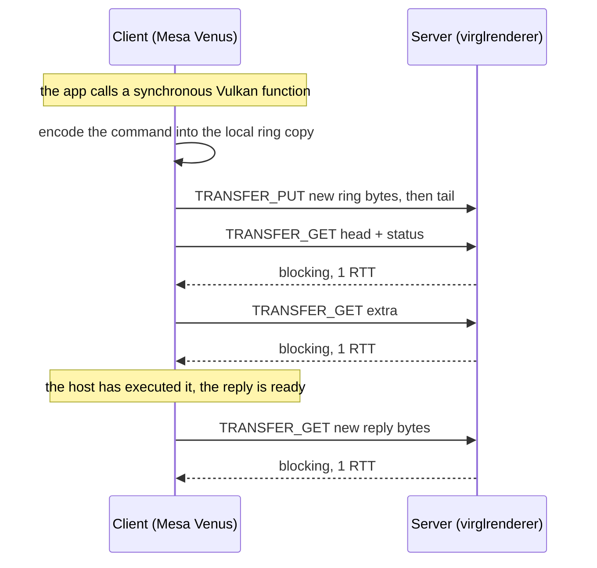

# GPU over IP: Vulkan on a remote GPU, over plain TCP

Run an unmodified Vulkan application on your own machine while its commands execute
on a GPU somewhere else on the internet. This project takes **Venus**, the Vulkan
command protocol that Mesa uses between a virtual machine and its host, and carries
it over an ordinary TCP connection instead of shared memory.

> **Status: research prototype.** From a home connection in Turkey, `vulkaninfo`
> enumerates and queries an NVIDIA A10G in AWS Frankfurt over the public internet,
> repeatably. It is not production software: there is no authentication or
> encryption, no rendering workload has completed yet, and the latest fix is built
> but not yet verified. Every number below was measured.

## Contents

- [Result at a glance](#result-at-a-glance)
- [How it works](#how-it-works)
- [Where the time goes](#where-the-time-goes)
- [Optimization history](#optimization-history)
- [Latest finding: 258 MB of wasted transfer per run](#latest-finding-258-mb-of-wasted-transfer-per-run)
- [Bugs found along the way](#bugs-found-along-the-way)
- [Dead ends](#dead-ends)
- [What this can and cannot do](#what-this-can-and-cannot-do)
- [Build and run](#build-and-run)
- [Reproducing the measurements](#reproducing-the-measurements)
- [Security](#security)
- [Repository layout and research log](#repository-layout-and-research-log)
- [Next steps](#next-steps)
- [License](#license)

## Result at a glance

| | |
|---|---|
| Client | Arch Linux laptop, residential internet connection in Turkey |
| Server | AWS `g5.xlarge`, `eu-central-1` (Frankfurt), NVIDIA A10G, driver 580 |
| Transport | Plain TCP to port 33445. No SSH tunnel, no VPN |
| Round-trip time | 64–67 ms on a good day, 80–107 ms on a bad one (TCP connect timing) |
| Workload | `vulkaninfo --summary` |
| Result | `deviceName = Virtio-GPU Venus (NVIDIA A10G)`, `driverName = venus`, exit code 0, repeated runs |
| Best full run | **236 s**, down from 435 s |
| Rendering | `vkcube` starts and no longer crashes, but has not drawn a frame |

236 seconds for `vulkaninfo` sounds absurd, and it is the central result rather than
an embarrassment. `vulkaninfo` issues several hundred synchronous queries and waits
for every answer, which makes it close to the worst case for a transport whose cost
is set by round trips. The rest of this document is about where those seconds go
and how to remove them.

Before going over the internet, the same patches worked locally over TCP against an
AMD GPU (`Virtio-GPU Venus (AMD Radeon Graphics (RADV RENOIR))`, Vulkan 1.4,
`DRIVER_ID_MESA_VENUS`); see
[`experiments/phase3-lan-transport/vulkaninfo-over-tcp-output.txt`](experiments/phase3-lan-transport/vulkaninfo-over-tcp-output.txt).

## How it works



The application sees an ordinary Vulkan device. Mesa's Venus driver serializes every
Vulkan call into a command stream; on the GPU machine, virglrenderer decodes the
stream and replays it against the real driver. Upstream, the two sides talk through
`vtest`, a test harness that connects them over a **Unix domain socket** on one
machine. This project turns that connection into a TCP socket.

### Why swapping the socket is not enough

Venus is designed for a guest and a host that **share physical memory**. The command
ring and the reply buffer are the same pages mapped on both sides, and each side
polls the other's progress counters directly. That memory is set up by passing file
descriptors over the Unix socket (`SCM_RIGHTS`).

A TCP socket can carry neither file descriptors nor shared memory. Replacing only
the socket type makes the client abort during instance creation, at the first point
where it expects to receive a file descriptor.

So each side keeps its own private copy of every shared region, and the patches keep
the copies coherent by copying bytes over the wire with vtest's existing
`TRANSFER_PUT` (opcode 5) and `TRANSFER_GET` (opcode 4) commands. These commands have
no byte-offset field, so the offset travels in the otherwise unused `box.x`. On the
server, blob resources are copied directly through their mapping, because the
standard transfer path assumes textures and fails for blobs.

### Who may write what

Blindly copying a region in both directions corrupts it: each side overwrites the
fields the other one just wrote with a stale copy. Coherence therefore follows field
ownership:

| Region | Field | Owner | Synchronized by |
|---|---|---|---|
| Command ring (131,268 bytes) | `head` (offset 0) | host | GET |
| | `tail` (offset 64) | guest | PUT, always **after** the buffer |
| | `status` (offset 128) | host | GET, merged with `head` into one request |
| | `buffer` (offset 192, 128 KiB) | guest | PUT, only the bytes written since the last push |
| | `extra` | host | GET |
| Reply pool (1 MiB) | everything | host | GET only, only the new span |
| Device memory | contents | either | PUT on flush, GET on invalidate |

On real shared memory, flushing or invalidating device memory costs nothing. Here
each one is a network transfer.

## Where the time goes

Every blocking round trip in the client is an artifact of emulating shared memory
over a socket, not something the Venus protocol itself requires. That reduces the
whole performance story to one equation:

```
time ≈ number of blocking round trips × round-trip time
```

One synchronous Vulkan call currently costs at least three blocking round trips:



The measurements agree with the diagram. In the 4 September run, with an RTT of about
89 ms, the fast ring syncs took about 175 ms (two round trips) and the fastest reply
syncs about 80 ms (one).

### Delay sweep on loopback

With `tc netem` adding a fixed one-way delay to loopback (so the RTT is twice the
delay), runtime grows in a straight line:

| Added delay, one way | RTT | `vulkaninfo --summary` | Implied sequential round trips |
|---|---|---|---|
| 10 ms | 20 ms | 20.75 s | ~1,040 |
| 20 ms | 40 ms | 40.82 s | ~1,020 |
| 40 ms | 80 ms | 81.16 s | ~1,010 |

All runs completed cleanly. A constant ~1,000 sequential round trips per run (with
the code of that time) is the signature of a purely latency-bound system.

This bench has a blind spot that was found later: it adds delay but no bandwidth
limit, so it cannot see problems caused by moving too many bytes. See the
[latest finding](#latest-finding-258-mb-of-wasted-transfer-per-run).

### The RTT is already close to physics

TCP connect time from the same home connection to AWS regional endpoints, measured on
31 August, 7 samples each (method and distances in
[`docs/research-notes/rtt-survey-2026-08-31.md`](docs/research-notes/rtt-survey-2026-08-31.md)):

| Region | Median | Min | Max |
|---|---|---|---|
| `eu-south-1` Milan | **56.5 ms** | 55.1 | 59.9 |
| `eu-central-1` Frankfurt | 66.1 ms | 64.2 | 67.5 |
| `eu-south-2` Spain | 91.1 ms | 84.6 | 178.4 |
| `eu-central-2` Zurich | 91.2 ms | 84.8 | 179.9 |
| `eu-west-1` Ireland | 92.5 ms | 88.3 | 171.8 |
| `me-central-1` UAE | 160.3 ms | 157.8 | 164.8 |

Light in fiber covers the 1,867 km from Istanbul to Frankfurt and back in about 19 ms,
so the measured 66 ms is about 3.5 times the physical floor, which is normal for
routed commercial internet. Moving to a closer region saves about 10 ms at best.
Reducing the **number** of round trips is the only lever with real headroom.

## Optimization history

All runs are `vulkaninfo --summary` against the A10G in Frankfurt unless noted. Note
numbers refer to [`experiments/phase4-wan-aws/`](experiments/phase4-wan-aws/).

| Step | Note | Measured |
|---|---|---|
| First run over the real internet, no WAN-specific work | 01 | 430 s. Profiling: 89% of the time inside network round trips. Each ring sync pushed the whole 128 KiB buffer; each reply sync pulled the whole 1 MiB pool |
| Ring delta push, merged `head` + `status` GET, reply-pool delta pull | 01 | Reply sync 780–900 ms → ~63 ms. Ring sync 730 ms → 120–140 ms. But 15–20% of samples still took 1–7 s |
| Data race fix (see below) | 02 | 435 s with zero crashes, ring sync average 156.9 ms. A 213,779-packet capture showed 5 retransmissions, ruling out packet loss |
| Pipelining: stop pushing the ring on every submit | 04 | **435 s → 236 s** (−46%), ring syncs 578 → 353 (−39%) |
| Reply-pool background thread, 2 ms → 100 ms period | 05 | On `vkcube`: 8 synchronous calls in 90 s → 15 in 60 s (about 2.8×) |
| Verification run of all of the above together | 07 | Crashed after 266 s and 282 sync calls, which led to the finding below |
| Bounded 8 KiB background pull (patch `0002`) | 07 | Built, **not yet verified** |

Comparing wall-clock times across days proved unreliable: during the first round,
full runs got slower (430 → 458 → 510 → 645 s) while individual syncs got faster.
Round-trip counts do not depend on the state of the network; wall-clock times do.

## Latest finding: 258 MB of wasted transfer per run

The 4 September verification run crashed, and its server log explained a problem that
had been misread for a week:

| Reply-pool `TRANSFER_GET` source | Count | Size of each |
|---|---|---|
| Background safety-net thread | **258** | the full 1 MiB pool |
| Active hook, after each reply | 31 | 24–64 bytes |

That is **258 MB** moved in 266 seconds, while the entire useful payload was about
**1.5 KB**. The delta logic runs only when the caller passes a size hint; the
background thread never passes one, so every pass pulls the whole pool.

The waste is enough to saturate a home downlink: at about 8 Mbps, the average rate of
the wasted transfer, one 1 MiB pull takes about a second, and it holds the client's
single socket while it runs. Small packets such as TCP connect probes still get
through, so the RTT looks normal while real transfers stall. The client's own log of
the run,
[`07-data-client-stderr-2026-09-04.txt`](experiments/phase4-wan-aws/07-data-client-stderr-2026-09-04.txt)
(one `[PROF]` line per sync), shows the fast case disappearing:

| Fifth of the run | Ring syncs | Median | Slower than 600 ms |
|---|---|---|---|
| first | 50 | 201 ms | 42% |
| second | 50 | 748 ms | 78% |
| third | 50 | 817 ms | 94% |
| fourth | 50 | 794 ms | 100% |
| last | 51 | 865 ms | 100% |

Then the connection dropped. An earlier session (note 06) saw exactly this picture —
flat RTT, idle GPU, known-good code — and blamed the internet provider. The loopback
bench never showed it because loopback has no bandwidth limit.

The fix keeps the background thread and its 100 ms period (deleting it outright was
tried and made things worse, for reasons not yet isolated) and limits each pass to an
8 KiB window starting where the active hook left off. It is
[`patches/mesa/0002-*.patch`](patches/mesa/), built and **not yet verified**. The test
that would falsify it: the full-pool transfers disappear from the server log, ring
syncs stay at about two round trips for the whole run, and the run completes.

The crash also exposed a separate weakness: on a failed socket read the client calls
`abort()` with no recovery, and a closed connection (a read returning 0) is not
treated as an error at all, which turns into an endless loop.

## Bugs found along the way

Each of these broke correctness, not just speed. All are written up in the log.

- **The render server could not start.** Venus runs its renderer in a subprocess by
  default, and spawning it failed with `ENOMEM`. Fixed by building virglrenderer with
  the render server in thread mode. *(phase 2, notes 04–05)*
- **A phantom byte.** The fd-passing helper sent one dummy byte even when no fd can
  travel, shifting the byte stream. It is now a no-op on TCP. *(phase 3, note 03)*
- **Blind copies overwrote the other side.** Fixed by the ownership table above.
  *(phase 3, note 04)*
- **Tail before buffer.** Pushing `tail` first let the host read a buffer that had
  not arrived yet. The buffer now always goes first. *(phase 3, note 04)*
- **A lock convoy.** One sync thread re-acquired the shared mutex so quickly that the
  reply-pool thread did not win it once in a 20-second run, so the client only ever
  saw an all-zero reply buffer. Fixed with a real sleep. *(phase 3, note 04)*
- **Trailing zero bytes.** Three uncoordinated sync paths (a background thread, a
  push hook, a pull hook) raced, and the host saw the last bytes of a command as
  zeros. *(phase 3, notes 06–07)*
- **A hidden second fd receive.** `vkDestroyInstance` waited forever in `recvmsg` for
  a file descriptor that TCP cannot deliver. On TCP the wait now returns success
  immediately. That is correct for the synchronous workloads tested so far; real
  asynchronous fences will need a notification channel from the host. *(phase 3,
  note 07)*
- **Half-written commands sent to the host.** The background thread could push the
  ring while the encoder was halfway through writing a command; the host failed to
  decode it and flagged the ring as fatal. Writes now happen under a lock (a
  recursive mutex, because the sync path re-enters it). *(phase 4, note 02)*
- **A counter that moved backwards.** The ring's write position was read outside the
  mutex but recorded inside it, so two threads could make the "last pushed" marker
  go backwards and trip an assertion. *(phase 4, note 01)*
- **Device memory assumed an fd.** Creating device memory asserted on a file
  descriptor that never arrives over TCP; `vkcube` crashed on it. Device memory now
  uses an anonymous mapping, with flush and invalidate turned into transfers.
  *(phase 4, note 03)*

## Dead ends

Tried, measured, and reverted. Listed so nobody has to try them again.

| Idea | Why it failed | Note |
|---|---|---|
| Swap the Unix socket for TCP and keep everything else | The client receives file descriptors during setup and aborts | phase 3, 01 |
| Use the newer `TRANSFER_GET2` / `PUT2` commands (13/14) | The server never reads their `data_size`, so every transfer moves 0 bytes | phase 3, 03 |
| Copy whole regions in both directions | Each side overwrites the other's fields with a stale copy | phase 3, 04 |
| Push `tail` before the buffer | The host reads a buffer that has not arrived yet | phase 3, 04 |
| Throttle the active pull to every 4th wait iteration | No measurable effect: waits succeed on the first iteration anyway | phase 3, 09 |
| Push the ring only when the host looks idle | 3/3 timeouts: asynchronous commands were never delivered | phase 3, 10 |
| Delete the reply-pool background thread | 8 synchronous calls in 10 minutes, ~485 ms average; cause not isolated | phase 4, 06 |

## What this can and cannot do

**Interactive rendering is out of reach at these distances, and no code change will
fix that.** At 60 frames per second a frame has 16.7 ms. A single blocking round trip
at 56–66 ms already exceeds that budget three to four times, which caps any design
with one round trip per frame at about 15–18 frames per second before any other cost.
Interactive graphics over a wide-area network belongs to pixel streaming, where the
application runs next to the GPU and only video travels back.

**API remoting fits work that submits a lot and waits rarely**: GPU compute,
batch processing, offline rendering, and cases where the application or its data has
to stay on the local machine. Latency there costs per synchronization point, not per
frame. The next target workload is therefore Vulkan compute rather than `vkcube`.

## Build and run

Tested with Mesa at
[`e9a87f8`](https://gitlab.freedesktop.org/mesa/mesa/-/commit/e9a87f80b2d6df916fffcd7798fdf9b7c57f3d58)
and virglrenderer at
[`7fcfce4`](https://gitlab.freedesktop.org/virgl/virglrenderer/-/commit/7fcfce49616974dc7050fdbfb5bb915f4448d270).
The server needs a Vulkan driver that Venus can run on; this was verified with
NVIDIA's proprietary driver 580 (A10G) and with Mesa RADV (AMD Renoir).

### 1. Get the sources and apply the patches

```bash
git clone https://gitlab.freedesktop.org/mesa/mesa.git vendor/mesa
git -C vendor/mesa checkout -b gpu-over-ip e9a87f80b2d6df916fffcd7798fdf9b7c57f3d58
git -C vendor/mesa am "$PWD"/patches/mesa/*.patch

git clone https://gitlab.freedesktop.org/virgl/virglrenderer.git vendor/virglrenderer
git -C vendor/virglrenderer checkout -b gpu-over-ip 7fcfce49616974dc7050fdbfb5bb915f4448d270
git -C vendor/virglrenderer am "$PWD"/patches/virglrenderer/*.patch
```

### 2. Build the server (the machine with the GPU)

```bash
cd vendor/virglrenderer
meson setup build -Dvenus=true -Dplatforms=egl \
    -Drender-server-mode=thread -Drender-server-worker=thread
ninja -C build
```

The two `render-server` options are required. Without them the renderer is spawned as
a subprocess, and context creation fails with `VTEST_CLIENT_ERROR_CONTEXT_FAILED`.

### 3. Build the client (the machine running the application)

```bash
cd vendor/mesa
meson setup build -Dvulkan-drivers=virtio -Dgallium-drivers= \
    -Dglx=disabled -Dplatforms=x11,wayland
ninja -C build
```

### 4. Run

On the server:

```bash
./build/vtest/virgl_test_server --no-fork --venus \
    --rendernode /dev/dri/renderD128 --socket-path tcp:33445
```

On the client, from `vendor/mesa`:

```bash
VTEST_SOCKET_NAME=tcp:<server-ip>:33445 \
VK_ICD_FILENAMES="$PWD/build/src/virtio/vulkan/virtio_icd.x86_64.json" \
    vulkaninfo --summary
```

Expect a device named `Virtio-GPU Venus (<your server GPU>)` with `driverName =
venus`. Read [Security](#security) before opening the port.

## Reproducing the measurements

**Count round trips, not seconds.** The client prints one `[PROF] sync_now
is_ring=<0|1> us=<microseconds>` line per sync to stderr, so the number of syncs and
their duration can be read from a log:

```bash
vulkaninfo --summary 2> client.log
grep -c '\[PROF\]' client.log                 # syncs in total
grep -c '\[PROF\] sync_now is_ring=1' client.log   # ring syncs
```

On the server, the full-pool transfers from the latest finding show up as
`transfer_get on reply-pool ... offset=0 size=1048576` lines.

**Emulate a wide-area link locally, without root**, in a throwaway user and network
namespace that does not touch the real network stack:

```bash
unshare --user --net --map-root-user sleep 3600 &
nsenter --target $! --net --user --preserve-credentials bash -c '
  ip link set lo up
  tc qdisc add dev lo root netem delay 35ms rate 10mbit
  # start the server and the client inside this same namespace
'
```

Add `rate` as above. The published delay sweep used `delay` alone, which is exactly
why it missed the bandwidth problem; the `rate` variant has not been run yet. A 35 ms
one-way delay gives a 70 ms RTT, similar to Turkey–Frankfurt.

## Security

**The protocol has no authentication and no encryption.** Anyone who can open a TCP
connection to port 33445 can send commands to the server's GPU driver, and anyone on
the path can read and alter them. Never expose the port to the internet. Restrict it
to your own address with a firewall or security-group rule, or reach the server
through an SSH tunnel or a VPN. If your home address changes, an address-based rule
fails silently: connections time out instead of being refused.

## Repository layout and research log

| Path | Contents |
|---|---|
| `patches/` | The changes to Mesa and virglrenderer as `git format-patch` series. **The canonical form of the code.** |
| `docs/research-notes/` | Phases 0–1: measurements, architecture survey, source reading |
| `experiments/phase2-local-poc/` | Phase 2: Venus end to end on one machine |
| `experiments/phase3-lan-transport/` | Phase 3: the TCP transport and shared-memory emulation |
| `experiments/phase4-wan-aws/` | Phases 4–5: the real internet, an AWS GPU, performance |
| `vendor/` | Local clones of Mesa and virglrenderer. Not tracked (about 700 MB). |

The notes were kept in Turkish while the work happened and were translated into
English on 16 October 2026; the original Turkish text is in commit
[`ad87ea8`](https://github.com/emirhancabukk/gpu-over-ip-research/tree/ad87ea88fcdb3311255b4b22ee3da57a4065fb3d).
Apart from the translation they are unedited and chronological: failed attempts stay
in, with the reason they failed, and where a later finding overturned a note, a dated
note at the top says so. "The user" in the notes is the project's author. An index:

**Phase 0–1** (`docs/research-notes/`)

| File | Summary |
|---|---|
| `phase0-network-measurement.md` | Baseline with curl: ~64 ms to Frankfurt, DNS lookup included; ICMP is blocked on the path |
| `phase0-azure-pivot.md` | AWS GPU quota requests denied; an Azure A10 instance considered instead |
| `phase1-prior-art-venus-and-rvgpu.md` | Why Venus (batches per command buffer) and not RVGPU (renders locally, streams the result) |
| `phase1-source-code-findings.md` | Source reading: the ring assumes truly shared, polled memory; resources travel as fds |
| `phase1-vtest-transfer-and-sync.md` | `TRANSFER_GET`/`PUT` and `SYNC_WAIT` are plain byte streams, a possible foundation |
| `rtt-survey-2026-08-31.md` | TCP-connect RTT to six AWS regions against the fiber floor: the path is normal, Milan is 10 ms closer |

**Phase 2: local proof of concept** (`experiments/phase2-local-poc/`)

| File | Summary |
|---|---|
| `01-build-and-smoke-test.md` | virglrenderer with Venus builds and the server starts on a local AMD GPU |
| `02-mesa-virtio-icd-and-first-e2e-attempt.md` | The Mesa Venus driver builds; the first end-to-end run fails with `CONTEXT_FAILED` |
| `03-context-failed-debugging.md` | The partial-read hypothesis is ruled out |
| `04-context-failed-root-cause.md` | Root cause: the render server subprocess fails to spawn (`ENOMEM`) |
| `05-SUCCESS-end-to-end.md` | Thread mode: Venus enumerates the real GPU end to end |

**Phase 3: TCP transport** (`experiments/phase3-lan-transport/`)

| File | Summary |
|---|---|
| `01-first-tcp-attempt-fd-passing-blocker.md` | Swapping the socket aborts at the first fd receive |
| `02-transfer-get-put-blob-mismatch.md` | Transfers fail on blob resources; the copy API assumes textures |
| `03-phantom-byte-fix-and-timing-issue.md` | `GET2`/`PUT2` move 0 bytes; back to opcodes 4/5; the phantom byte |
| `04-ring-corruption-and-stale-replies.md` | Field ownership, buffer before tail, reply pool GET-only, the lock convoy |
| `05-reply-sync-now-hook-and-remaining-flaky-cs-error.md` | A synchronous reply pull when the reply is ready fixes stale replies |
| `06-active-push-pull-hooks-faster-new-data-loss.md` | Active push/pull hooks: faster, and a new data-loss bug |
| `07-SUCCESS-phase3-complete.md` | Phase 3 complete: `vulkaninfo` over TCP; three racing sync paths found |
| `08-tc-netem-artificial-delay-results.md` | Delay sweep: runtime scales linearly with delay |
| `09-pipelining-attempt-negative-result.md` | Pull throttling: no measurable gain |
| `10-idle-conditional-push-failed-reverted.md` | Idle-conditional push: 3/3 timeouts, reverted |
| `11-ring-fallback-thread-restored-safely.md` | A 5 ms fallback thread restores delivery guarantees |
| `vulkaninfo-over-tcp-output.txt` | Full `vulkaninfo --summary` output from the first successful run over TCP |

**Phases 4–5: the real internet** (`experiments/phase4-wan-aws/`)

| File | Summary |
|---|---|
| `01-SUCCESS-real-aws-gpu-over-the-internet.md` | A real AWS GPU over the internet; profiling and the first optimization round |
| `02-CRITICAL-race-condition-found-and-fixed.md` | Half-written commands reached the host; fixed with a lock, crash gone |
| `03-device-memory-transport-works-but-slow.md` | Device memory over TCP: `vkcube` stops crashing, but is far too slow |
| `04-SUCCESS-pipelining-435s-to-236s.md` | Pipelining: 435 s → 236 s |
| `05-reply-pool-background-thread-fix-and-vkcube-status.md` | Reply-pool thread 2 ms → 100 ms; where `vkcube` stops |
| `06-stall-network-variability-session-stopped.md` | A stall blamed on the network; overturned by note 07 |
| `07-ROOT-CAUSE-background-thread-258MB-wasted-transfer.md` | Root cause: 258 MB of wasted transfer per run; the crash in `vtest_read` |
| `07-data-client-stderr-2026-09-04.txt` | Raw client stderr of that run: 282 `[PROF]` lines, one per sync |

## Next steps

In dependency order:

1. **Verify patch `0002`** under netem with a bandwidth limit, then over the real
   internet.
2. **Make socket reads survive errors**: no `abort()` on a failed read, and treat a
   closed connection as an error instead of looping.
3. **Replace the `[PROF]` and `[DEBUG]` prints with a proper round-trip counter**, so
   every change is judged by a number that does not depend on the network.
4. **Cut round trips per call from three towards one**: fold the `extra` read into
   the `head` + `status` request, have the server send replies without being asked,
   and track dirty ranges so device-memory flushes skip unchanged bytes.
5. **Move to a Vulkan compute workload** as the main benchmark.

## License

- **Code and patches** (`patches/`): [MIT](LICENSE), the same license as the Mesa and
  virglrenderer files they modify. The patched files keep their upstream copyright
  notices.
- **Research notes and documentation** (`docs/`, `experiments/`, this README):
  [Creative Commons Attribution 4.0](LICENSE-docs). Reuse them freely, including
  commercially, with credit.

Mesa and virglrenderer are separate projects with their own authors and licenses;
this repository contains only the changes. Citation metadata is in
[`CITATION.cff`](CITATION.cff).
